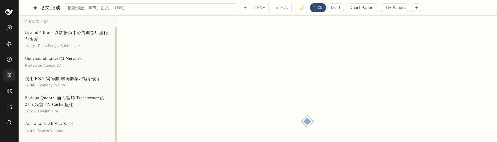

# dsh-paper-reader

> 在 [DeepSeek Harness](https://github.com/deepseek-ai) 里阅读论文：上传 PDF → 自动翻译成中文（TeX 公式渲染）→ 章节大纲、全文搜索、页内问答与手动配图编辑。

- **框架与内容分离**：插件只负责界面与流程，论文内容放在 `content/` 目录，可自由增删。
- **左栏入口 + 主区内嵌**：不是悬浮窗，而是 DSH 左侧导航里的「论文阅读」，右侧整块嵌入阅读器。
- **翻译可干预**：运行日志实时可见，失败原因具体到章节；可以用自然语言让编辑代理重译、改标题、改元信息、调图。



---

## 功能

| 能力 | 说明 |
|---|---|
| PDF 解析 | 逐页文本 + 图注定位；支持小型大写标题（`1 I NTRODUCTION`）与无编号标题 |
| 自动翻译 | 按章节调用模型翻译为中文，公式保留 `\( ... \)`，KaTeX 渲染 |
| 元信息 | 自动抽取标题（中/英）、作者、会议、年份、摘要 |
| 配图 | 内嵌位图按显示尺寸过滤（自动丢掉 emoji/小图标）；矢量图按图注区域裁剪 |
| 表格 | `pdfplumber` 抽取表格结构，代理可整理合并单元格后转成 HTML 插入正文 |
| 目录与搜索 | 章节大纲、滚动高亮、标题/章节/正文全文搜索（⌘K） |
| 页内问答 | 选中章节后提问，DeepSeek 作答并保存在该论文的问答库 |
| 运行日志 | 逐条记录解析、切节、每节翻译、失败原因与耗时；可中断任务 |
| 指令代理 | 在日志面板用自然语言下指令（重译某节、恢复预览、改标题、删图…），模型自主调用工具 |
| 手动配图 | 只动图片：删除、移动、按页框选重裁、补加漏图 |
| 主题 | 浅色 / 深色，跟随系统并可记忆 |
| 分区 | 默认 `Draft` 固定；可新建、改名、排序、删除（论文自动移入 Draft） |

## 安装

要求：DSH（桌面版或 `dsh` CLI）、Node.js ≥ 20；PDF 解析需要 Python 3，macOS 上额外使用系统 `swift` 做页面渲染。

**Python 依赖会自动安装**：首次执行解析/裁剪/表格抽取时，插件会用系统 `python3` 在 `tools/.venv` 建一个虚拟环境并安装 `pypdf`、`pillow`、`pdfplumber`（需要网络）。也可手动预装：

```bash
python3 -m venv tools/.venv
tools/.venv/bin/pip install pypdf pillow pdfplumber
```

```bash
# 进入插件目录
cd dsh-paper-reader

# 安装到某个 profile（示例：desktop）
dsh plugin --profile desktop add .
```

安装后重启 DSH，左栏出现「论文阅读」入口。

> 若使用 DSH 桌面版，profile 由应用管理；安装命令同上，重启应用生效。

## 快速开始

1. 打开「论文阅读」；
2. 点 **＋ 上传 PDF**，选择论文；
3. 底部「日志」会显示解析与翻译进度；状态点：灰=空闲 / 橙=运行中 / 绿=完成 / 黄=部分失败 / 红=失败；
4. 完成后即可阅读：`中文` / `问答` / `PDF` 三个标签，左侧目录，顶部搜索。

上传的论文会自动进入当前分区（默认 `Draft`），可随时移动到其它分区。

## 手动配图

点顶栏 **「✎ 图片」** 进入编辑模式（只影响图片，正文与公式不参与）：

- **删除**：点图片 → `删除这张图`；
- **移动**：点图片 → `移动图片…` → 点击目标段落（图片插到该段之前），或「放到章节末尾」；
- **重新裁剪**：点图片 → `重新框选裁剪` → 选页码 → 在页面上拖框 → 保存即替换；
- **补加漏图**：点 **「＋ 添加图片」** → 选页码与章节 → 拖框 → 保存，然后点正文段落决定位置。

所有修改写回 `content/<id>/sections.json` 并重新拼装 `zh.html`，只改动 `` 节点。

## 配置

- **模型**：打开「日志」面板右上角选择 provider / model，写入 `~/.dsh/paper-reader/settings.json`，下次翻译生效。
- **环境变量**：

| 变量 | 作用 |
|---|---|
| `DSH_PAPER_PROVIDER` | 默认 provider（如 `deepseek-account`） |
| `DSH_PAPER_MODEL` | 默认模型（如 `deepseek-flash`） |
| `DSH_PYTHON` | 指定 Python 解释器（默认使用 DSH 内置 Python，回退 `python3`） |
| `DSH_HOME` | DSH 数据目录（问答与设置存放处） |

## 内容格式

```
content/
├── collections.json          # 分区表（drafts 固定）
├── index.json               # 由构建脚本生成的索引（可选）
└── <paper-id>/
    ├── meta.json            # 标题、作者、会议、年份、摘要、章节大纲、状态
    ├── sections.json        # 逐节原文/译文/成功标记（编辑以它为准）
    ├── zh.html              # 由 sections 拼装出的中文正文（只读视图）
    ├── paper.pdf            # 原文 PDF
    ├── figures/             # 配图
    ├── qa.json              # 内置问答（可选，随内容分发）
    └── job.json             # 运行日志与状态
```

`zh.html` 是 HTML 片段，公式写作 `\( ... \)`；图片用
`/paper-reader/api/paper/<id>/figures/<file>` 引用。

仓库只带一个最小示例（`content.example/`），论文内容与 PDF 不入库。

## 工具脚本

| 脚本 | 用途 |
|---|---|
| `tools/pdf_ingest.py <pdf> <outdir>` | 解析逐页文本与内嵌图片 |
| `tools/extract_figures.py <pdf> <outdir>` | 图注定位 + 区域裁剪配图 |
| `tools/pdf_layout.py <pdf> <page> ...` | 版面查询（行坐标、图注、候选空白带） |
| `tools/render_pages.swift <pdf> <outdir> <scale>` | PDF 整页渲染（macOS PDFKit） |
| `tools/build-content.py [--only quant\|llm]` | 从 HTML 版论文批量生成 `content/` |
| `tools/backfill-pdfs.py` | 把工作区已有 PDF 复制进 `content/<id>/paper.pdf` |
| `tools/check_quality.py` | 对照原始网页检查章节/图/表结构 |
| `tools/pdf_tables.py <pdf> <page>` | 抽取某页表格为二维数组（供代理转 HTML） |
| `tools/check_upload.py <id>` | 检查上传论文的成品完整度 |
| `tools/dev-server.mjs` | 本地开发服务器（mock 模型） |
| `tools/install.sh` | 安装插件到 DSH profile 的辅助脚本 |

## HTTP API

| 方法 | 路径 | 说明 |
|---|---|---|
| GET | `/paper-reader/api/library` | 论文 + 分区 |
| GET/POST/PATCH/DELETE | `/paper-reader/api/collections[/<id>]` | 分区增删改（支持 `move: up/down`） |
| POST | `/paper-reader/api/upload?name=&collection=` | 上传 PDF（原始字节体） |
| GET | `/paper-reader/api/paper/<id>` | 元数据 + 问答 |
| GET | `/paper-reader/api/paper/<id>/zh` | 中文正文 HTML |
| GET | `/paper-reader/api/paper/<id>/pdf` | 原 PDF |
| GET | `/paper-reader/api/paper/<id>/page-image/<n>` | 第 n 页渲染图（框选用） |
| POST | `/paper-reader/api/paper/<id>/figure/{crop,insert,replace,remove,move}` | 手动配图 |
| GET/POST | `/paper-reader/api/job/<id>[/instruction\|/cancel]` | 运行日志、下指令、中断 |
| GET | `/paper-reader/api/models` | 可用 provider / model |
| POST | `/paper-reader/api/ask` | 页内问答 |

## 架构

```
lib/index.js   宿主侧：路由、内容存储、解析与翻译管线、代理工具
lib/client.js  客户端侧：左栏入口（sidebar.panellist）+ 主区面板（main）
assets/        阅读器前端（原生 JS + KaTeX），以 iframe 嵌入主区
```

- 客户端与阅读器同源，通过 `postMessage` 同步搜索、分区、主题与任务状态；
- 翻译与代理任务异步执行，日志写入 `job.json`，前端轮询展示；
- 所有内容操作限定在 `content/` 内，路径做白名单校验。

## 已知限制

- 翻译质量取决于所选模型；长论文耗时较长（按章节串行调用）；
- 矢量图裁剪依赖图注位置，版式复杂时可能裁偏，建议用「手动配图」修正；
- 表格以文本形式保留，未重建为 HTML 表格；
- 页面渲染依赖 macOS `swift`/PDFKit；其它平台需自行提供等价渲染。

## 免责声明

本仓库不包含任何论文 PDF 或译文。使用本项目处理论文时，请遵守原文的版权与许可；由使用者自行承担内容合规责任。

## English

A DeepSeek Harness plugin that turns PDFs into readable Chinese papers: automatic section-wise translation with TeX rendering, outline, full-text search, in-page Q&A, and a manual figure editor (delete / move / re-crop / add). Content lives in `content/` and is not bundled; only a minimal example is shipped.

## License

MIT
